# Classificazione di tumori cerebrali da immagini MRI


Pipeline di deep learning per classificare immagini di **risonanza magnetica (MRI) cerebrale** in quattro classi:
**glioma**, **meningioma**, **pituitary** (tumore ipofisario) e **no_tumor**.

Il progetto confronta due approcci:

- una **CNN custom** allenata da zero;
- un modello di **transfer learning** basato su EfficientNetB0 pre-addestrata su ImageNet.

Più che inseguire l'accuratezza massima, il lavoro punta su una **metodologia corretta**:

- eliminazione dei duplicati tra dataset diversi, per evitare il data leakage;
- mitigazione del domain shift tra scanner e ospedali;
- valutazione che tocca il test set una sola volta;
- interpretabilità tramite Grad-CAM.

> Progetto del corso **Artificial Intelligence in Medicine** — Politecnico di Torino
> **Autori:** Sofia Girolami, Francesco Fabrizi, Aurora Gennaro

---

## Indice

1. [Contesto](#1-contesto)
2. [Obiettivo e contributi](#2-obiettivo-e-contributi)
3. [Dataset](#3-dataset)
4. [Workflow](#4-workflow)
5. [Fase 1 – Analisi esplorativa e deduplicazione](#5-fase-1--analisi-esplorativa-e-deduplicazione)
6. [Fase 2 – Preprocessing](#6-fase-2--preprocessing)
7. [Fase 3 – Modelli e training](#7-fase-3--modelli-e-training)
8. [Metodologia di valutazione](#8-metodologia-di-valutazione)
9. [Risultati](#9-risultati)
10. [Discussione e limiti](#10-discussione-e-limiti)
11. [Conclusioni e sviluppi futuri](#11-conclusioni-e-sviluppi-futuri)
12. [Struttura del repository](#12-struttura-del-repository)
13. [Installazione ed esecuzione](#13-installazione-ed-esecuzione)
14. [Riproducibilità](#14-riproducibilità)
15. [Crediti dei dataset](#15-crediti-dei-dataset)

---

## 1. Contesto

### Il problema clinico

I tumori del sistema nervoso centrale non sono tra i più frequenti, ma hanno un impatto sproporzionato su sopravvivenza e qualità della vita. Nella pratica clinica:

- la **risonanza magnetica** è lo standard per rilevare, localizzare e monitorare in modo non invasivo le masse tumorali;
- la **biopsia** resta necessaria per la conferma istologica definitiva.

Leggere una MRI richiede molto tempo, risente della stanchezza del medico e dei limiti dell'occhio umano. Il risultato dipende quindi molto dall'esperienza del radiologo.

### Il ruolo dell'intelligenza artificiale

L'AI non sostituisce il medico: è un **sistema di supporto alla decisione clinica**. Può:

- automatizzare il triage;
- fornire una "seconda opinione" immediata;
- ridurre i falsi negativi dovuti all'errore umano.

Lo stato dell'arte è dominato dal deep learning applicato alla computer vision.

### Il gap che affrontiamo

Molti lavori in letteratura riportano accuratezze altissime, spesso intorno al 99%. Il trasferimento di questi modelli nella pratica clinica è però ostacolato da due problemi:

- **Domain shift.** I modelli spesso falliscono su dati acquisiti con scanner o in ospedali diversi da quelli di training.
- **Data leakage.** Molti studi uniscono più dataset pubblici ignorando che tra loro ci sono moltissime immagini in comune. Senza una deduplicazione tra sorgenti, la stessa immagine può finire sia nel training sia nel test. Il modello la "ricorda" invece di generalizzare, e le metriche risultano gonfiate.

---

## 2. Obiettivo e contributi

**Obiettivo:** sviluppare un modello di deep learning che classifichi le MRI cerebrali in 4 classi, dando priorità a correttezza e interpretabilità.

I due gap della sezione precedente vengono affrontati così:

- **Mitigazione del *source confound*.** Si impedisce al modello di "barare" riconoscendo il dataset di provenienza invece della patologia. Lo si ottiene con la normalizzazione per immagine e con la verifica tramite Grad-CAM.
- **Prevenzione del data leakage.** Le immagini duplicate, anche tra dataset diversi, vengono rimosse con un *perceptual hash* **prima** di qualsiasi split.

**Contributi principali:**

1. Una **pipeline di preprocessing guidata dai dati**: clipping ai percentili e z-score calcolato solo sul cervello, pensata per cancellare la "firma" dello scanner.
2. Un **framework di valutazione robusto**:
   - validazione incrociata stratificata a 5 fold;
   - test set separato e usato una sola volta;
   - metriche robuste allo sbilanciamento;
   - interpretabilità con Grad-CAM.

---

## 3. Dataset

Le immagini provengono da tre dataset pubblici, per un totale di **7.799 immagini etichettate**:

| Sorgente | Ruolo nel progetto | Classi usate |
|---|---|---|
| **Figshare** (Cheng et al.) | Scansioni T1 con contrasto di alta qualità: il nucleo dei campioni tumorali | glioma, meningioma, pituitary |
| **SARTAJ** | Aggiunge variabilità "reale" e diversità tra ospedali | glioma, meningioma, pituitary, no_tumor |
| **Br35H** | Fornisce la classe di controllo *no_tumor* | no_tumor |

I nomi delle cartelle originali (`glioma_tumor`, `notumor`, `Br35H_no`, …) vengono mappati sulle 4 classi canoniche tramite `RAW_LABEL_MAP` in `task1_eda.py`. La cartella **"yes" di Br35H è scartata**: contiene tumori senza indicazione del sottotipo, quindi non è compatibile con la classificazione a 4 classi.

**Composizione prima e dopo la deduplicazione:**

| Classe | Figshare | SARTAJ | Br35H | **Totale prima** | **Totale dopo** |
|---|---:|---:|---:|---:|---:|
| glioma | 1426 → 1421 | 897 → 863 | – | 2323 | **2284** |
| meningioma | 708 → 707 | 937 → 809 | – | 1645 | **1516** |
| pituitary | 930 → 925 | 901 → 824 | – | 1831 | **1749** |
| no_tumor | – | 500 → 187 | 1500 → 841 | 2000 | **1028** |
| **Totale** | 3064 → 3053 | 3235 → 2683 | 1500 → 841 | **7799** | **6577** |

La composizione per sorgente non è uniforme: il **75% dei *no_tumor* viene da Br35H** (l'82% dopo la deduplicazione), mentre i tumori vengono solo da Figshare e SARTAJ. È proprio il *confound* descritto sopra: un modello potrebbe imparare a riconoscere "un'immagine di Br35H" invece di "un cervello sano".

<p align="center">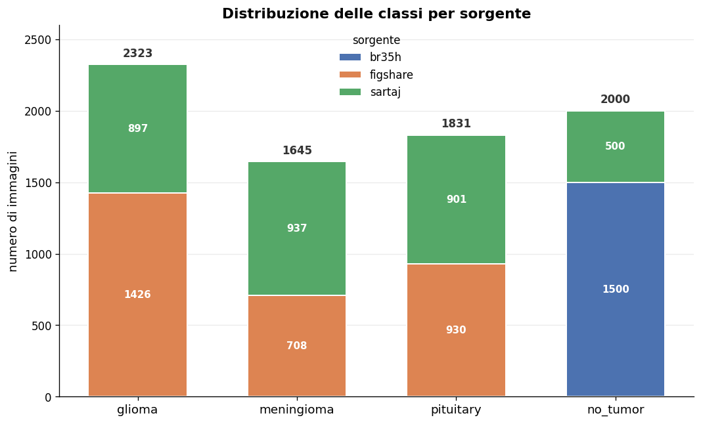</p>

---

## 4. Workflow

```mermaid
flowchart LR
    A["1. Dati grezzi<br/>e mappatura etichette<br/>(7.799 immagini)"] --> B["2. EDA e controlli<br/>di integrità"]
    B --> C["3. Deduplicazione<br/>pHash<br/>(6.577 immagini)"]
    C --> D["4. Split stratificato<br/>85/15<br/>(test = 987, bloccato)"]
    D --> E["5. 5-fold CV su trainval<br/>(preprocessing +<br/>augmentation)"]
    E --> F["6. CNN custom<br/>(ricerca iperparametri)<br/>vs EfficientNetB0"]
    F --> G["7. Riaddestramento<br/>finale su tutto<br/>il trainval"]
    G --> H["8. Valutazione unica<br/>sul test + Grad-CAM<br/>+ analisi errori"]
```

| Passo | File |
|---|---|
| 1–3 | `task1_eda.py` |
| 4–5 | `task2_preprocessing.py` |
| 6–8 | `task3_modelli.py` |

---

## 5. Fase 1 – Analisi esplorativa e deduplicazione

File: **`task1_eda.py`**. Contiene anche la configurazione condivisa del progetto (percorsi, classi, iperparametri, seed), importata dagli altri due task.

### 5.1 Manifest e controlli di integrità

Per ogni immagine viene creata una riga `id, path, label, source`, salvata in `outputs/manifest.csv`. Su tutte le 7.799 immagini si controllano:

- file corrotti o vuoti;
- immagini "RGB" che in realtà sono grigie con i tre canali identici.

### 5.2 Eterogeneità del dataset

- **Risoluzioni molto diverse:** larghezza da 150 a 1920 pixel e altezza da 167 a 1446 pixel, con 444 risoluzioni distinte.
  - Figshare è uniforme a 512×512.
  - SARTAJ e Br35H sono eterogenei.
- **Canali diversi:**
  - Figshare è a 1 canale.
  - SARTAJ è RGB a canali identici.
  - Br35H è misto, con 3 immagini RGBA.
  - L'analisi dei canali conferma che nessuna immagine contiene colore reale, quindi la conversione in scala di grigi non perde informazione.
- **Piani anatomici misti:** assiale, sagittale e coronale.

<p align="center">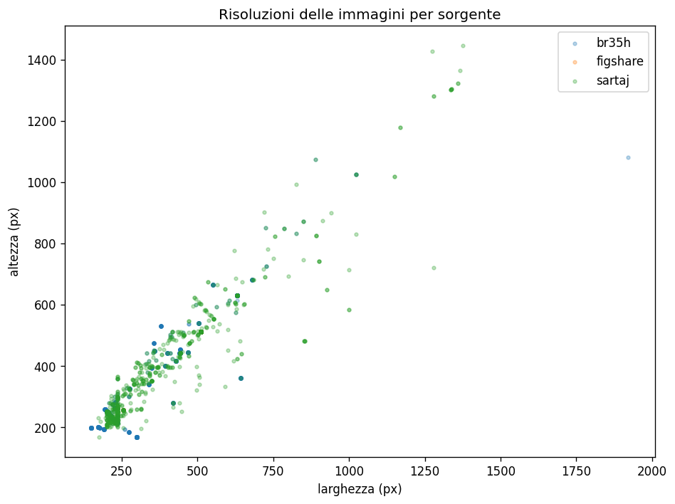</p>

### 5.3 Domain shift

Le distribuzioni dell'intensità media dei pixel sono **visibilmente diverse tra le sorgenti**: Br35H, in particolare, è spostato verso valori più alti. È la prova quantitativa del domain shift, ed è il motivo principale per cui abbiamo scelto una normalizzazione **per immagine** invece che globale (vedi §6.1).

<p align="center">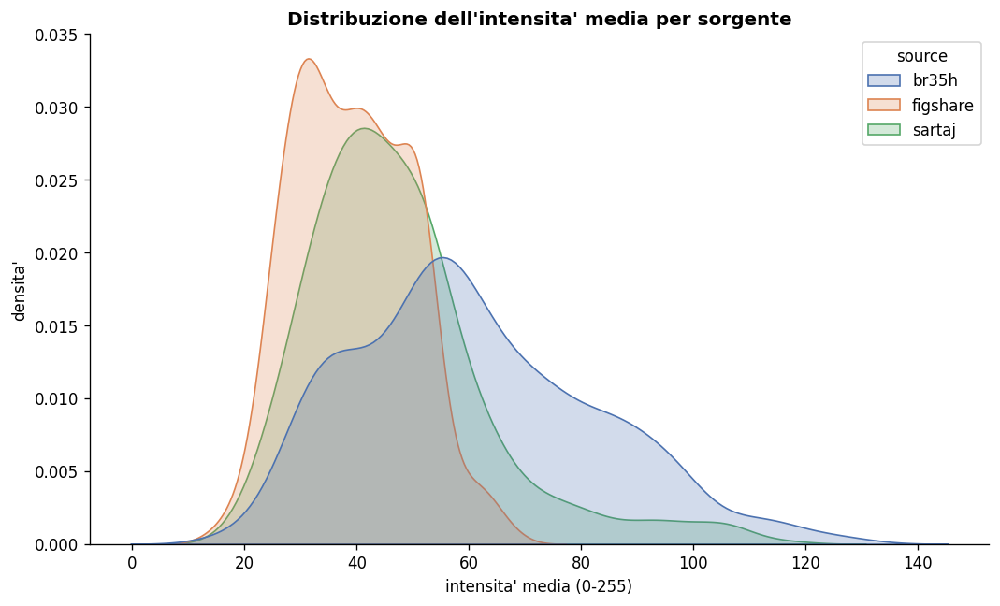</p>

### 5.4 Deduplicazione con perceptual hash

Unendo più dataset pubblici, le stesse slice compaiono più volte, spesso caricate con nomi diversi. Se non vengono rimosse, finiscono silenziosamente sia nel training sia nel test.

**Come si calcola l'hash.** È un pHash implementato in NumPy puro, senza dipendenze esterne:

1. l'immagine viene convertita in grigio e ridimensionata a 32×32;
2. si applica la DCT 2D;
3. si tengono le 8×8 frequenze più basse;
4. ogni coefficiente diventa un bit (1 se è sopra la mediana), per un **hash da 64 bit**.

**Quando due immagini sono duplicate.** Si calcola la distanza di Hamming tra i loro hash: sono considerate duplicate se la distanza è sotto una soglia.

**Come è stata scelta la soglia.**

1. Si è studiata la distribuzione della distanza di ogni immagine dal suo vicino più prossimo: lo "spike" a sinistra corrisponde ai veri duplicati.
2. Si sono confrontate le soglie 2, 3 e 5.
3. Si è scelta la più restrittiva: **1 bit su 64**, cioè immagini praticamente identiche.

| Soglia (bit) | Duplicati rimossi | di cui cross-source | con classe diversa dal rappresentante |
|---:|---:|---:|---:|
| 1 (scelta) | 1222 | 244 | 6 |
| 2 | 1714 | 250 | 9 |
| 3 | 1714 | 250 | 9 |
| 5 | 2484 | 256 | 24 |

**Quale copia si tiene.** L'algoritmo è *greedy*: quando trova un duplicato tiene la copia della sorgente più affidabile, con priorità Figshare > Br35H > SARTAJ.

**Risultato:** 1.222 immagini rimosse, da 7.799 a **6.577**.

- 244 duplicati sono **cross-source**, tutti tra Br35H e SARTAJ.
- 978 sono slice quasi identiche all'interno dello stesso dataset.

**Controllo sulle etichette.** Per ogni soglia si conta anche quanti duplicati hanno un'etichetta diversa dal loro rappresentante: un valore alto indicherebbe una soglia troppo larga. Con soglia 1 i casi sono solo 6 su 1.222, contro 24 a soglia 5.

---

## 6. Fase 2 – Preprocessing

File: **`task2_preprocessing.py`**

### 6.1 Normalizzazione: clip + z-score sul solo cervello

La CNN custom normalizza ogni immagine indipendentemente, in tre passi.

1. **Clip ai percentili [1°, 99°] dell'immagine.** Elimina gli outlier dovuti ad artefatti dello scanner, che altrimenti distorcerebbero media e deviazione standard.
2. **Maschera "cervello".** Sono i pixel strettamente sopra la soglia bassa del clip. Una slice MRI è in gran parte sfondo nero: calcolare le statistiche sull'intera immagine le schiaccerebbe verso il basso e comprimerebbe la variabilità che conta, quella dentro il tessuto.
3. **Z-score** con media e deviazione standard calcolate solo sul cervello: `(x − μ_cervello) / σ_cervello`. Il tessuto risulta centrato su zero con varianza unitaria, mentre lo sfondo finisce a un valore negativo quasi costante.

**Perché per immagine e non globale.** Una media e una deviazione standard globali, fissate una volta sul training set, non correggono lo spostamento di intensità di una sorgente mai vista in training. La normalizzazione per immagine invece si adatta a ogni scansione senza bisogno di sapere da dove viene, e così "cancella la firma dello scanner". È anche più semplice da gestire dal punto di vista del leakage, perché non ci sono statistiche da stimare sul training.

<p align="center">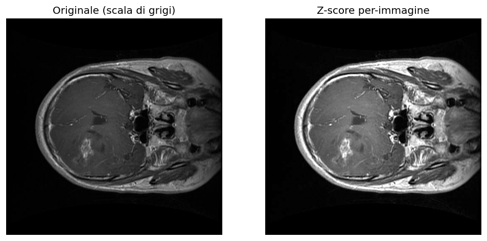</p>

**Confronto quantitativo.** Si sono confrontati quattro schemi: originale con clip, min-max, z-score per immagine e z-score globale. Per ciascuno si è misurato quanto variano tra un'immagine e l'altra le intensità del tessuto: coefficiente di variazione del 75° percentile su 300 immagini, dove più basso significa più allineato.

| Schema | CV del 75° percentile |
|---|---:|
| Originale (clip) | 0.352 |
| Min-max (0–1) | 0.193 |
| **Z-score per immagine** | **0.220** |
| Z-score globale | 0.894 |

Lo z-score globale lascia le sorgenti disallineate, quasi 4 volte peggio dello z-score per immagine. Le due normalizzazioni per immagine si equivalgono; lo z-score è stato preferito perché porta il tessuto a media nulla e varianza unitaria, una scala più adatta all'input di una rete convoluzionale con BatchNorm.

<p align="center">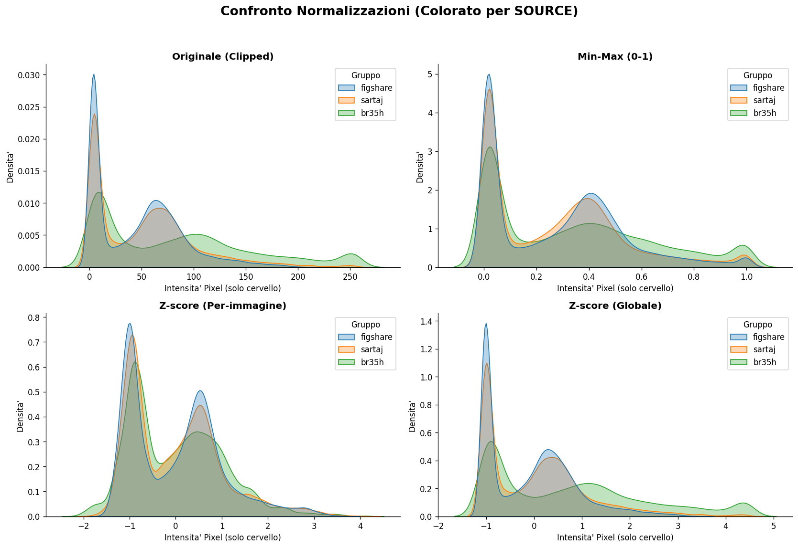</p>

**Ramo transfer learning.** EfficientNetB0 non usa questa normalizzazione ma il suo `preprocess_input`, così riceve esattamente le statistiche su cui sono stati addestrati i pesi ImageNet.

### 6.2 Split train/test e validazione incrociata

- **Hold-out stratificato 85/15:** 5.590 immagini di *trainval* e **987 di test**. Il test viene messo da parte e non si tocca fino alla valutazione finale.
- **5-fold stratificata sul trainval:** circa 4.472 immagini di training e 1.118 di validazione per fold. Serve a scegliere il modello e gli iperparametri.
- Entrambi gli split preservano le proporzioni delle classi (per esempio glioma 34,7% nel trainval e 34,8% nel test) e, approssimativamente, anche quelle delle sorgenti.
- Lo split è **uno solo**, salvato su disco (`outputs/trainval.csv` con colonna `fold` e `outputs/test.csv`) e riusato da tutte le fasi, per evitare incoerenze e leakage.

<p align="center">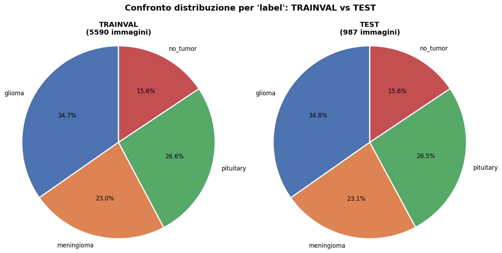</p>

### 6.3 Pesi delle classi

Anche dopo la pulizia il dataset resta sbilanciato: la classe più numerosa ha 2,2 volte gli esempi della meno numerosa. Si usano quindi **pesi inversamente proporzionali alla frequenza**, calcolati solo sul trainval e applicati in tutte le fasi di training:

| glioma | meningioma | pituitary | no_tumor |
|---:|---:|---:|---:|
| 0.72 | 1.09 | 0.94 | 1.60 |

### 6.4 Data augmentation

L'augmentation si applica **solo al training**, mai a validazione o test. La stessa policy è usata per CNN e transfer learning, così tra i due modelli cambiano solo normalizzazione e backbone.

| Tipo | Trasformazioni |
|---|---|
| Geometriche | rotazione ±12°, traslazione orizzontale/verticale 5%, zoom 10%, shear 8°, flip orizzontale |
| Fotometriche | luminosità 0,9–1,1 |
| Escluse | **flip verticale** |

- **Flip orizzontale:** il cervello è approssimativamente simmetrico, quindi una slice specchiata resta anatomicamente plausibile.
- **Niente flip verticale:** invertirebbe l'orientamento superiore/inferiore e produrrebbe un'immagine anatomicamente impossibile.
- **Variazione di luminosità:** compensa le differenze residue di intensità che la normalizzazione per immagine non elimina del tutto.

Le immagini vengono ridimensionate a **224×224×3**, il formato richiesto da EfficientNetB0. Per uniformità lo stesso formato è usato anche dalla CNN.

<p align="center">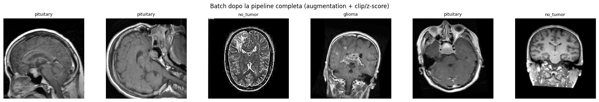</p>

---

## 7. Fase 3 – Modelli e training

File: **`task3_modelli.py`**

### 7.1 CNN custom

È composta da quattro blocchi convoluzionali e da una testa di classificazione leggera:

```
Input 224×224×3
 → Conv 3×3 (16)  + BatchNorm + MaxPool 2×2
 → Conv 3×3 (32)  + BatchNorm + MaxPool 2×2
 → Conv 3×3 (64)  + BatchNorm + MaxPool 2×2
 → Conv 3×3 (64)  + BatchNorm + MaxPool 2×2
 → GlobalAveragePooling
 → Dense 128 (ReLU) + Dropout 0.5
 → Dense 4 (softmax)
```

- **Estrattore di feature:** i canali crescono a ogni blocco, mentre il MaxPool dimezza ogni volta la risoluzione spaziale. La BatchNorm dopo ogni convoluzione stabilizza il training su input già normalizzati con lo z-score.
- **Testa:** il GlobalAveragePooling tiene basso il numero di parametri rispetto alle circa 5.600 immagini disponibili e aggiunge invarianza alla traslazione. Il Dropout 0.5 regolarizza la testa.

Sono state confrontate **tre taglie**. Differiscono solo per il numero di filtri e per la dimensione dello strato denso; numero di blocchi, kernel e architettura restano gli stessi.

| Taglia | Filtri | Dense | Parametri |
|---|---|---:|---:|
| **small** (scelta) | 16 → 32 → 64 → 64 | 128 | ~70 k |
| base | 32 → 64 → 128 → 128 | 256 | ~276 k |
| big | 32 → 64 → 128 → 256 | 512 | ~524 k |

### 7.2 Transfer learning: EfficientNetB0

```
EfficientNetB0 (pesi ImageNet, ~4 M parametri) → GlobalAveragePooling → Dropout 0.3 → Dense 4 (softmax)
```

Il fine-tuning avviene **in due fasi**:

| Fase | Epoche | Learning rate | Backbone |
|---|---:|---:|---|
| A – feature extraction | 8 | 1e-3 | completamente congelato, si allena solo la testa |
| B – fine-tuning | 8 | 1e-5 | si scongelano gli **ultimi 20 layer** |

- **Primi layer congelati:** conservano rilevatori generici di bordi e texture, probabilmente utili anche dopo il salto di dominio tra immagini naturali e MRI.
- **Ultimi blocchi scongelati:** adattano alle MRI le rappresentazioni più specifiche del compito.
- **Learning rate basso in fase B:** evita di sovrascrivere troppo i pesi pre-addestrati una volta scongelati.

### 7.3 Protocollo di training

- **Ottimizzazione:** ottimizzatore Adam, loss categorical cross-entropy, batch size 32 fisso. Il batch size non è stato incluso nella ricerca: il budget è andato agli iperparametri più rilevanti.
- **Arresto adattivo** invece di un numero fisso di epoche:
  - `EarlyStopping` sulla `val_loss`, che ripristina i pesi dell'epoca migliore;
  - `ReduceLROnPlateau` (fattore 0,3), che abbassa il learning rate quando la loss si blocca.
  - La pazienza della riduzione del learning rate è più corta di quella dell'early stopping. Il sistema prova prima ad abbassare il learning rate; si ferma solo se nemmeno così la loss migliora.

| Modello | Pazienza ReduceLROnPlateau | Pazienza EarlyStopping | Epoche massime |
|---|---:|---:|---:|
| Transfer learning (per fase) | 2 | 3 | 8 + 8 |
| CNN custom | 3 | 6 | 30 |

- **Pesi delle classi** applicati in ogni fase di training.

### 7.4 Ricerca degli iperparametri della CNN

Una grid search completa sarebbe stata troppo costosa, quindi si è usata una **ricerca coordinata in due passi** su un *proxy veloce*:

- un solo fold;
- un sottocampione del 35% per classe;
- risoluzione ridotta a 128×128.

**Passo 1 – learning rate** (taglia fissata a *base*):

| Learning rate | val. accuracy |
|---:|---:|
| **1e-3** | **0.837** |
| 3e-4 | 0.784 |
| 1e-4 | 0.772 |

**Passo 2 – taglia della rete** (learning rate fissato a 1e-3):

| Taglia | val. accuracy |
|---|---:|
| **small** | **0.815** |
| base | 0.806 |
| big | 0.788 |

**Run di controllo.** Si ripete una seconda volta la configurazione *base* con learning rate 1e-3. Se il risultato è quasi identico al primo, le differenze tra configurazioni sono un effetto reale degli iperparametri e non rumore casuale del training.

**Validazione completa.** I vincitori del proxy non sono stati presi per buoni: le due taglie più vicine (*small* e *base*) sono state rivalidate con la **5-fold completa a 224×224** prima del training finale (vedi §9.1).

Per il transfer learning i due learning rate (1e-3 e 1e-5) non sono stati cercati: seguono la pratica standard del fine-tuning.

### 7.5 Modelli finali

Dopo la selezione, entrambi i modelli vengono **riaddestrati sull'intero trainval** (5.590 immagini). Un nuovo split interno di validazione dell'85/15 serve solo per l'early stopping. Il test continua a restare fuori.

---

## 8. Metodologia di valutazione

**Perché non l'accuratezza semplice.** Il dataset resta sbilanciato e glioma è il 34,7% delle immagini: l'accuratezza potrebbe nascondere prestazioni scarse sulle classi minoritarie. Le metriche principali sono quindi:

- **Balanced accuracy:** media delle sensibilità per classe.
- **Macro-F1:** media non pesata degli F1 per classe.

**Suite completa di metriche:**

- **Precision, recall e F1 per classe:** distinguono i casi mancati dai falsi positivi.
- **Matrice di confusione**, in conteggi e normalizzata per riga: mostra quali classi vengono confuse tra loro.
- **Specificità per classe:** quantifica il tasso di falsi positivi.
- **ROC-AUC one-vs-rest** (macro): misura la capacità discriminativa indipendentemente dalla soglia. Si usa la versione one-vs-rest perché le classi sono 4, non 2.
- **Curve Precision-Recall** e macro AP, come complemento più sensibile allo sbilanciamento.

**Protocollo anti-leakage in tre stadi:**

1. **5-fold stratificata solo sul trainval**, per scegliere modello e iperparametri.
2. **Riaddestramento sul trainval**, con un nuovo split di validazione usato solo per l'early stopping.
3. **Test set separato**, toccato **una sola volta**, alla fine, per entrambi i modelli.

---

## 9. Risultati

### 9.1 Validazione incrociata (5 fold sul trainval)

| Modello | Balanced accuracy | Macro-F1 |
|---|---:|---:|
| EfficientNetB0 (transfer learning) | 0.875 ± 0.006 | 0.866 ± 0.005 |
| **CNN custom – small** | **0.915 ± 0.020** | **0.911 ± 0.019** |
| CNN custom – base | 0.913 ± 0.019 | 0.908 ± 0.020 |

È stata scelta la CNN *small*: ha il punteggio medio più alto sui 5 fold con una variabilità bassa (deviazione standard ≤ 0,02), cioè è stabile. Inoltre, a parità di prestazioni, è il modello più leggero.

### 9.2 Training, validazione e test

| Modello | Train (ultima epoca) | Validazione CV (5-fold) | **Test (held-out)** |
|---|---:|---:|---:|
| EfficientNetB0 | ≈ 0.88 acc. | 0.875 bal. acc. | **0.878** bal. acc. |
| CNN custom – small | ≈ 0.92 acc. | 0.915 bal. acc. | **0.945** bal. acc. |

**Risultati finali sul test set (987 immagini):**

| Modello | Balanced accuracy | Macro-F1 | Macro ROC-AUC | Macro AP |
|---|---:|---:|---:|---:|
| EfficientNetB0 | 0.878 | 0.869 | 0.980 | 0.943 |
| **CNN custom – small** | **0.945** | **0.939** | **0.992** | **0.981** |

**Come si leggono questi numeri:**

- Le accuratezze di training e validazione restano vicine: non ci sono segni di overfitting.
- La CNN finale fa un po' meglio sul test che in validazione incrociata. È coerente con il fatto che il modello finale è allenato sull'intero trainval (5.590 immagini) e non sull'80% usato in ogni fold (4.472 immagini).
- Il transfer learning sul test (0,878) è molto vicino alla sua stima in validazione incrociata (0,875).

<p align="center">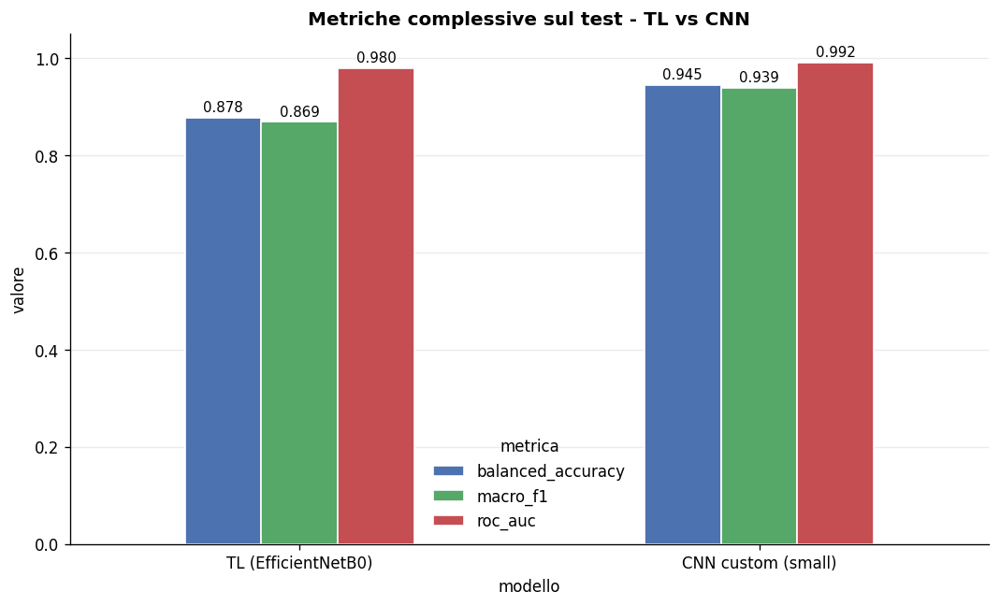</p>

### 9.3 Matrici di confusione (test, normalizzate per riga)

<p align="center">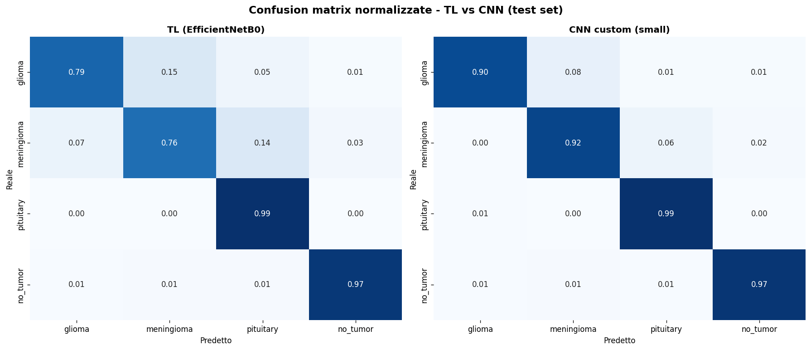</p>

**Sensibilità per classe** (la diagonale delle matrici):

| Classe | EfficientNetB0 | CNN small | Differenza |
|---|---:|---:|---:|
| glioma | 0.79 | **0.90** | +11 punti |
| meningioma | 0.76 | **0.92** | +16 punti |
| pituitary | 0.99 | 0.99 | = |
| no_tumor | 0.97 | 0.97 | = |

- Il punto debole del transfer learning è la coppia **glioma–meningioma**: il 15% dei gliomi viene classificato come meningioma. C'è anche una perdita in una sola direzione, dal meningioma verso pituitary (14%).
- La CNN custom migliora nettamente proprio queste due classi.
- **Pituitary** e **no_tumor** sono quasi al massimo (≥ 0,97) per entrambi i modelli.

È un risultato clinicamente rilevante: distinguere un glioma da un meningioma è difficile anche per i radiologi.

<p align="center">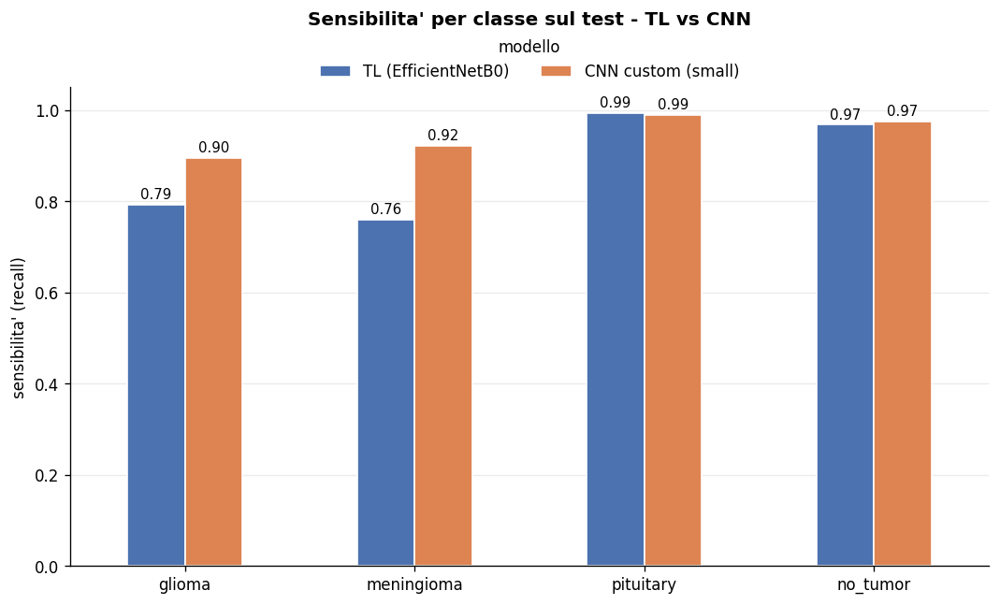</p>

### 9.4 Curve ROC e Precision-Recall

| Classe | AUC – TL | AUC – CNN | AP – TL | AP – CNN |
|---|---:|---:|---:|---:|
| glioma | 0.977 | 0.992 | 0.963 | 0.988 |
| meningioma | 0.947 | 0.981 | 0.829 | 0.958 |
| pituitary | 0.996 | 0.997 | 0.988 | 0.990 |
| no_tumor | 0.998 | 0.997 | 0.992 | 0.987 |

Entrambi i modelli separano pituitary e no_tumor in modo quasi perfetto. Il meningioma è la classe più difficile, coerentemente con le confusioni viste nelle matrici; con la CNN la sua AP sale da 0,83 a 0,96.

<p align="center">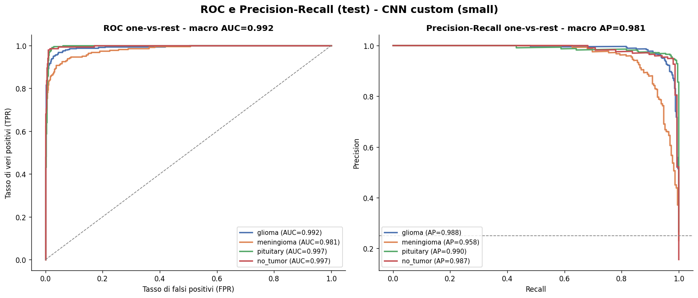</p>
<p align="center">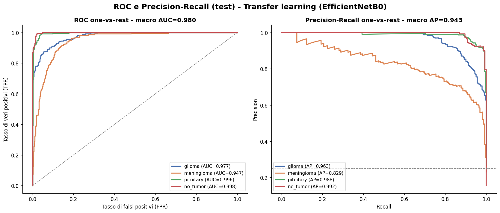</p>

### 9.5 Curve di training

In entrambi i modelli le curve di training e validazione restano vicine e la loss di validazione non risale: non c'è overfitting. Verso la fine le curve si appiattiscono, e l'early stopping interrompe il training a convergenza.

La differenza di prestazioni tra i due modelli riflette quindi una vera differenza di capacità, non un overfitting da una delle due parti.

<p align="center">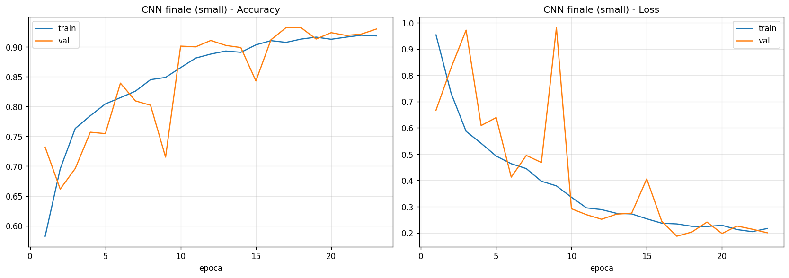</p>
<p align="center">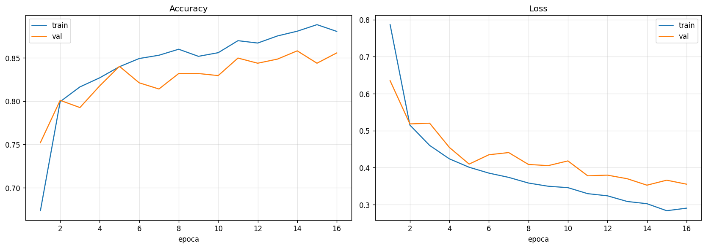</p>

### 9.6 Interpretabilità: Grad-CAM

Grad-CAM produce mappe di calore che mostrano quali regioni dell'immagine hanno guidato la predizione.

- **Predizioni corrette di glioma e meningioma:** l'attenzione è concentrata sulla lesione. Il modello guarda il tumore, non i bordi o gli artefatti della scansione.
- **L'unico errore mostrato** (un pituitary predetto come glioma): l'attenzione è diffusa sulla base cranica, segno che il modello si è appoggiato a una regione poco specifica.
- **no_tumor:** le attivazioni sono distribuite sul parenchima normale, coerentemente con l'assenza di una lesione focale. Non si concentrano su bordi o artefatti tipici di Br35H, l'unica sorgente con molti *no_tumor*. È il controllo che serviva per escludere che il modello riconosca la sorgente invece dell'assenza di patologia.

<p align="center">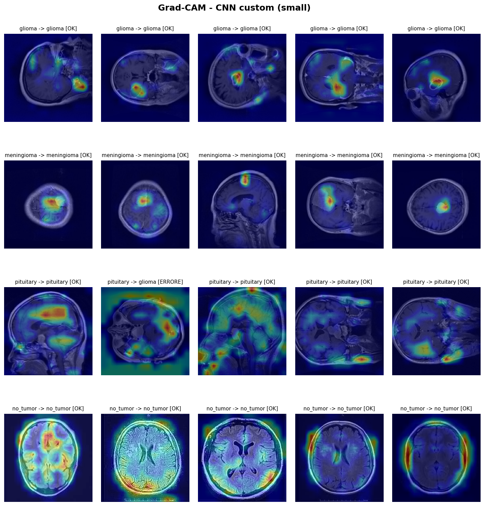</p>

<details>
<summary>Grad-CAM del modello di transfer learning</summary>
<p align="center">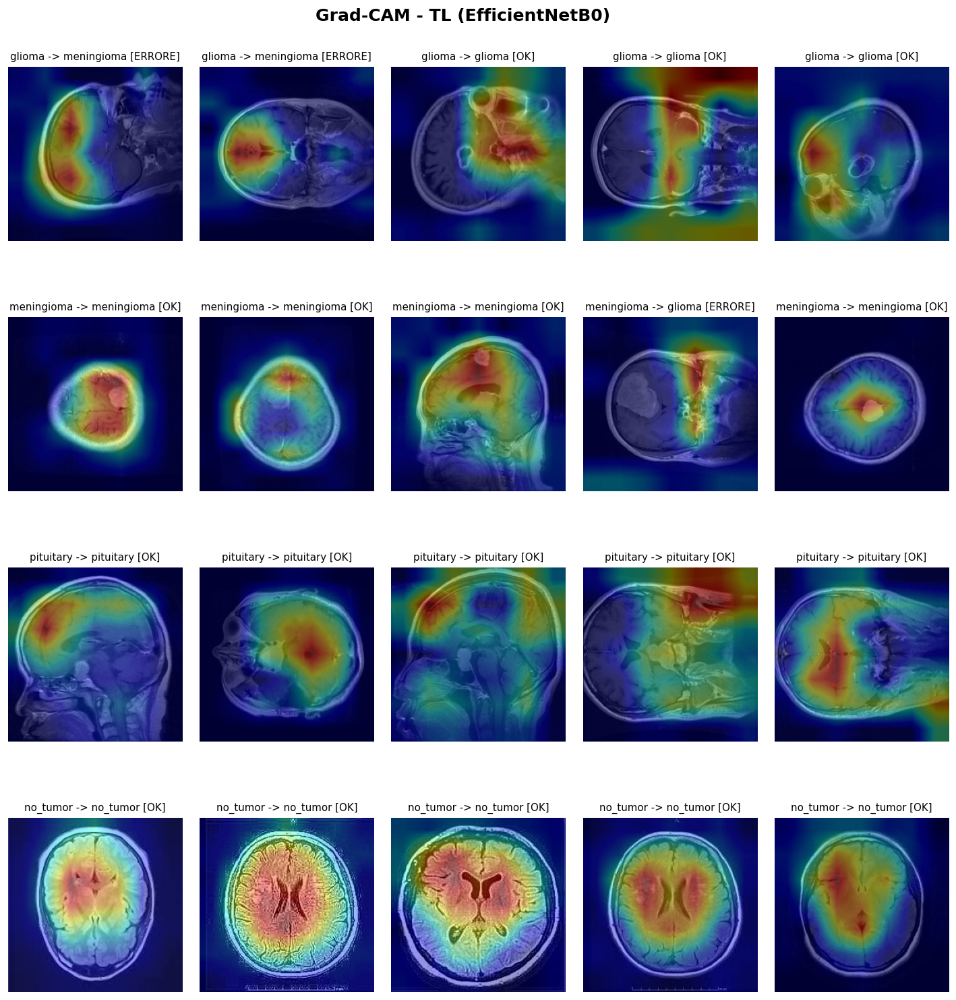</p>
</details>

### 9.7 Analisi degli errori

Quasi tutti gli errori cadono al confine tra **glioma, meningioma e pituitary**: tipi di tumore che, a seconda del piano di taglio e della posizione, possono apparire molto simili.

<p align="center">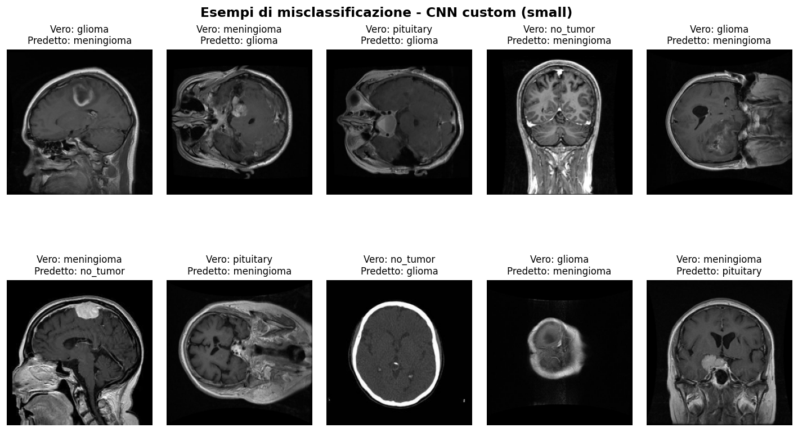</p>

<details>
<summary>Casi classificati male dal modello di transfer learning</summary>
<p align="center">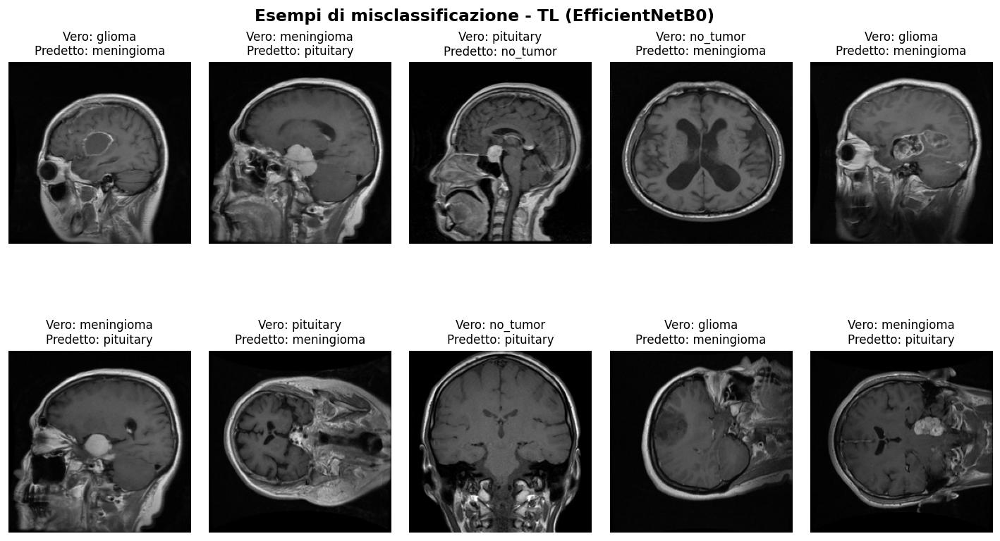</p>
</details>

> Le figure di Grad-CAM, delle curve ROC/PR e delle misclassificazioni sono state prodotte con script di analisi separati, eseguiti sui modelli finali, che non fanno parte di questo repository.

---

## 10. Discussione e limiti

### Confronto con la letteratura

Molti studi recenti che uniscono dataset MRI pubblici riportano accuratezze intorno al 99%. Spesso però sono gonfiate da immagini duplicate e data leakage tra training e test. Questo progetto sceglie di dare priorità alla pulizia dei dati. Le accuratezze ottenute sono più basse, ma più oneste.

### Perché la CNN custom batte il transfer learning?

A prima vista sembra controintuitivo, ma ci sono due spiegazioni:

- **Dominio lontano.** EfficientNetB0 è pre-addestrata su ImageNet, cioè su foto di oggetti, animali e scene, molto diverse da slice MRI in scala di grigi. Con circa 5.600 immagini il vantaggio del pre-training su un dominio così distante si riduce. Una piccola CNN costruita per il compito si specializza meglio, senza dover "disimparare" feature irrilevanti.
- **Meno parametri, più generalizzazione.** Per lo stesso motivo la CNN *small* (circa 70k parametri) batte le varianti più grandi: con pochi dati, meno parametri spesso generalizzano meglio.

La deviazione standard tra i fold resta sotto 0,02, quindi il distacco di circa 4 punti in validazione incrociata (0,915 contro 0,875) appare consistente e non casuale. Non è stato però eseguito un test statistico formale.

### Punti di forza

- **Affidabilità clinica:** metriche bilanciate (macro-F1, sensibilità) invece dell'accuratezza semplice, e pesi delle classi per lo sbilanciamento.
- **Prevenzione dell'overfitting:** early stopping, riduzione del learning rate, dropout e augmentation.

### Compromessi

- **Architetture semplici.** Non sono stati usati Vision Transformer o ensemble complessi. I ViT richiedono in genere dataset molto più grandi; con circa 5.600 immagini rischierebbero l'overfitting e si perderebbero leggerezza e interpretabilità.
- **Ridimensionamento.** Le immagini vengono ridimensionate con interpolazione *nearest-neighbor*, il default dei generatori Keras, invece di una bilineare.

### Limiti

- **Rischio di "scorciatoia".** La classe *no_tumor* proviene quasi solo da Br35H: il modello potrebbe in parte riconoscere la sorgente invece della patologia. Il rischio è mitigato con la normalizzazione per immagine e verificato con Grad-CAM, ma non eliminato del tutto.
- **Piani anatomici misti.** Assiale, sagittale e coronale vengono trattati allo stesso modo.
- **Indipendenza a livello di paziente.** I dataset non pubblicano identificativi dei pazienti, quindi non si può garantire che slice dello stesso paziente non finiscano sia in training sia in test. La deduplicazione pHash agisce come salvaguardia solo a livello di immagine.
- **Generalizzazione a nuovi ospedali.** Senza un quarto dataset esterno, la robustezza su scanner mai visti non è dimostrata sperimentalmente.

---

## 11. Conclusioni e sviluppi futuri

È stata costruita una pipeline completa per la classificazione a 4 classi dei tumori cerebrali, che privilegia la robustezza clinica rispetto a metriche artificialmente gonfiate.

**Contributi chiave:**

- **Zero data leakage:** i duplicati tra dataset sono stati cercati ed eliminati con perceptual hashing *prima* dello split.
- **Firma dello scanner cancellata:** la normalizzazione z-score per immagine mitiga il domain shift e spinge la rete a imparare l'anatomia.
- **Validazione rigorosa:** 5-fold stratificata e un test set mai toccato fino alla valutazione finale.

**Sviluppi futuri:**

- **Federated learning:** allenare il modello su più ospedali senza centralizzare dati sensibili dei pazienti, aumentando la robustezza al domain shift.
- **Edge deployment:** comprimere il modello perché giri direttamente sull'hardware ospedaliero.
- **Consapevolezza anatomica e demografica:** gestire esplicitamente i diversi piani MRI e integrare metadati per mitigare bias algoritmici.

---

## 12. Struttura del repository

```
.
├── task1_eda.py             # Configurazione condivisa + Fase 1: manifest, integrità, EDA, deduplicazione pHash
├── task2_preprocessing.py   # Fase 2: split, fold, class weight, normalizzazione, augmentation
├── task3_modelli.py         # Fase 3: transfer learning, CNN custom, k-fold, modelli finali, test
├── requirements.txt         # Dipendenze (CPU, o GPU su Linux)
├── requirements-wsl.txt     # Dipendenze per GPU NVIDIA sotto WSL2
├── environment-gpu.yml      # Ambiente conda per GPU NVIDIA su Windows nativo (TF 2.10)
└── docs/img/                # Figure usate in questo README
```

Cartelle generate durante l'esecuzione, escluse da git:

| Cartella | Contenuto |
|---|---|
| `extracted_datasets/` | dataset scompattati |
| `outputs/` | manifest, split, pesi delle classi, figure |
| `MRI_DATA_DIR` | zip dei dataset, pesi dei modelli, risultati della k-fold (vedi sotto) |

---

## 13. Installazione ed esecuzione

### 1. Ambiente

Scegli uno dei tre file in base al tuo sistema:

```bash
pip install -r requirements.txt            # CPU (o GPU su Linux)
pip install -r requirements-wsl.txt        # GPU NVIDIA sotto WSL2
conda env create -f environment-gpu.yml    # GPU NVIDIA su Windows nativo (TensorFlow 2.10)
```

Su Windows nativo TensorFlow ≥ 2.11 non supporta più la GPU: per questo esistono le varianti WSL2 e conda. La pipeline è stata verificata anche con TensorFlow 2.21 e Python 3.13.

### 2. Dati

Scarica i tre dataset (vedi [§15](#15-crediti-dei-dataset)) e mettili come zip in una cartella:

- `figshare.zip`, con le immagini già in JPG, una cartella per classe;
- `SARTAJ.zip`;
- `Br35H_no.zip`.

Di default la cartella è `data/` dentro il repository. Puoi indicarne un'altra, per esempio una cartella sincronizzata con Google Drive, con la variabile d'ambiente `MRI_DATA_DIR`:

```powershell
$env:MRI_DATA_DIR = "G:\My Drive\medicine"     # Windows (PowerShell)
```
```bash
export MRI_DATA_DIR="/percorso/della/cartella"  # Linux / macOS / WSL
```

In quella stessa cartella vengono salvati anche i pesi dei modelli e i risultati della k-fold.

### 3. Esecuzione

Le tre fasi vanno eseguite in ordine: ognuna legge i file prodotti dalla precedente.

```bash
python task1_eda.py            # → outputs/manifest.csv, outputs/manifest_dedup.csv
python task2_preprocessing.py  # → outputs/trainval.csv, outputs/test.csv, outputs/class_weight.json
python task3_modelli.py        # training, k-fold, modelli finali, confronto sul test
```

- **Figure:** sono salvate in `outputs/figures/` e mostrate a schermo. Per eseguire senza finestre imposta `MPLBACKEND=Agg`.
- **Durata del task 3:** allena 5 fold × 3 configurazioni più i modelli finali, quindi richiede **ore su CPU**; è consigliata una GPU. Per una prova veloce abbassa `EPOCHS_A`, `EPOCHS_B` ed `EPOCHS_CNN` in cima a `task3_modelli.py`.

---

## 14. Riproducibilità

- **Seed:** è fissato a `SEED = 111` per Python, NumPy e TensorFlow, e usato in split, fold, campionamenti e augmentation.
- **Ordine dei file:** il manifest viene costruito in un ordine fisso, per nome del file senza distinzione tra maiuscole e minuscole. Così deduplicazione e split producono gli stessi risultati su Windows, Linux e macOS.
- **Split unico:** è salvato su disco e riusato da tutte le fasi.
- **Margine di variazione:** i risultati di training possono variare leggermente tra esecuzioni e hardware diversi, per il non-determinismo delle operazioni su GPU.

---

## 15. Crediti dei dataset

- **Figshare:** J. Cheng et al., *Brain tumor dataset*, Figshare. Vedi anche Cheng et al., "Enhanced Performance of Brain Tumor Classification via Tumor Region Augmentation and Partition", *PLoS ONE*, 2015. https://figshare.com/articles/dataset/brain_tumor_dataset/1512427
- **SARTAJ:** S. Bhuvaji et al., *Brain Tumor Classification (MRI)*, Kaggle. https://www.kaggle.com/datasets/sartajbhuvaji/brain-tumor-classification-mri
- **Br35H:** A. Hamada, *Br35H :: Brain Tumor Detection 2020*, Kaggle. https://www.kaggle.com/datasets/ahmedhamada0/brain-tumor-detection

I dataset **non sono inclusi** nel repository e restano soggetti alle licenze delle rispettive fonti.

---

> ⚠️ **Nota:** progetto a scopo didattico e di ricerca. I modelli **non** sono validati per l'uso clinico e non devono essere usati per decisioni diagnostiche.
